<!-- contribution graph: real data, redrawn daily by .github/workflows/update-profile-art.yml -->

<h3><code>usman@github ~ $ ./contributions.sh</code></h3>

 
 

<!-- portrait: python scripts/make_ascii.py | card: python scripts/make_info_card.py -->

<h3><code>usman@github ~ $ whoami</code></h3>

<table>
<tr>
<td valign="top"></td>
<td valign="top"></td>
</tr>
</table>

 
 

<h3><code>usman@github ~ $ ./links.sh</code></h3>

